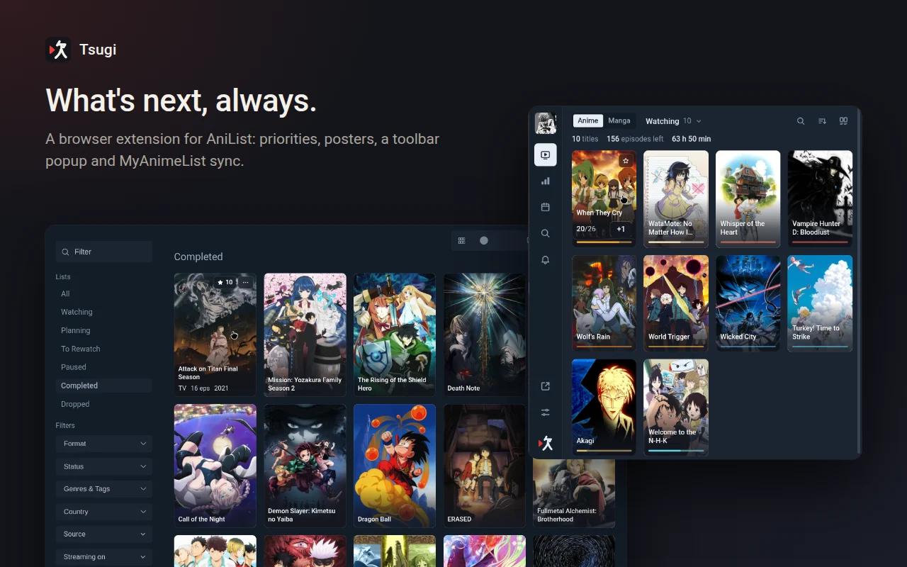
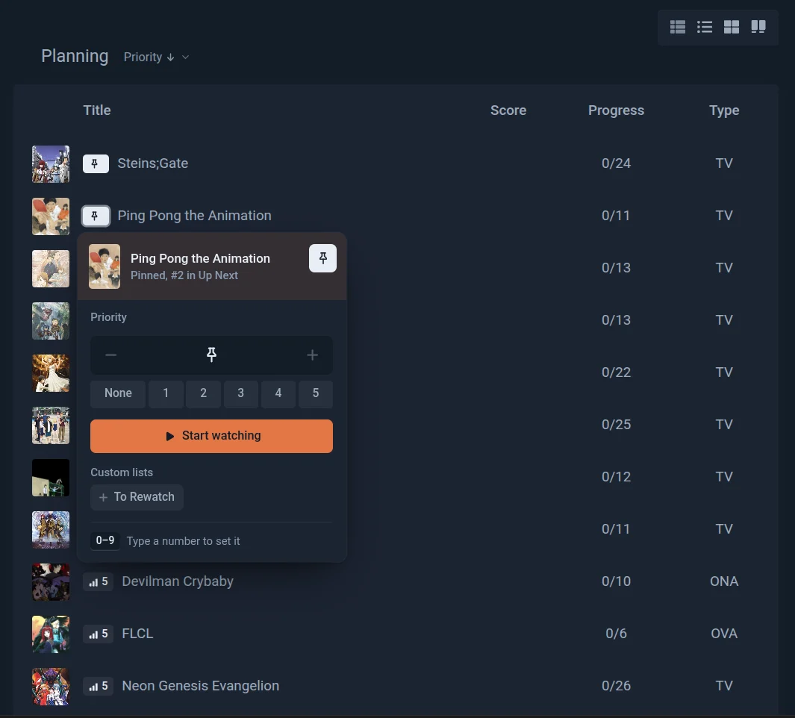
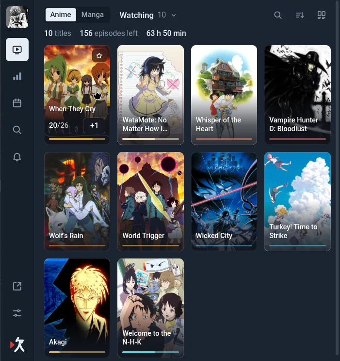
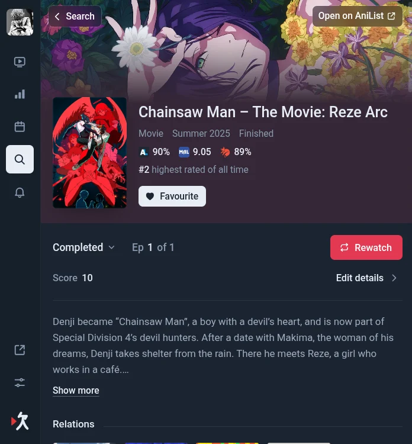
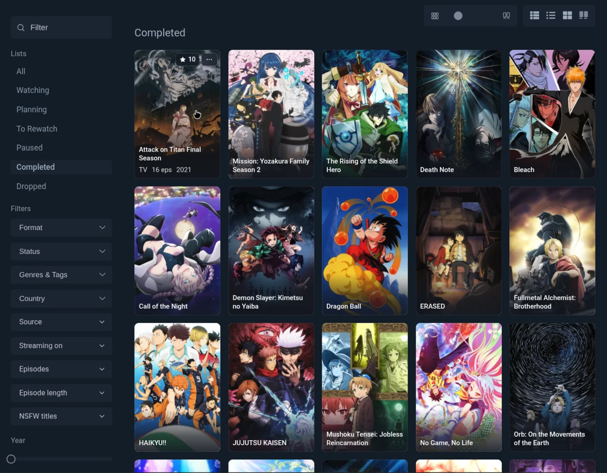
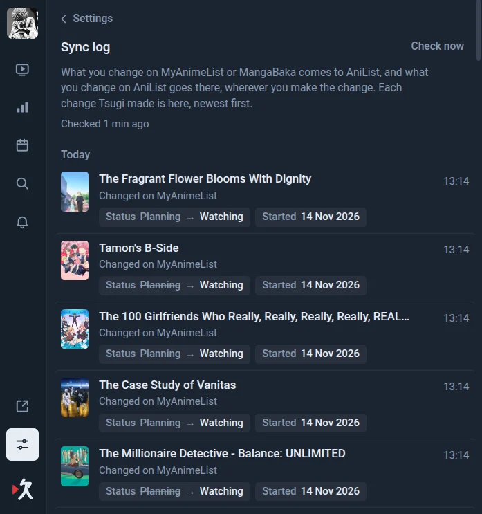
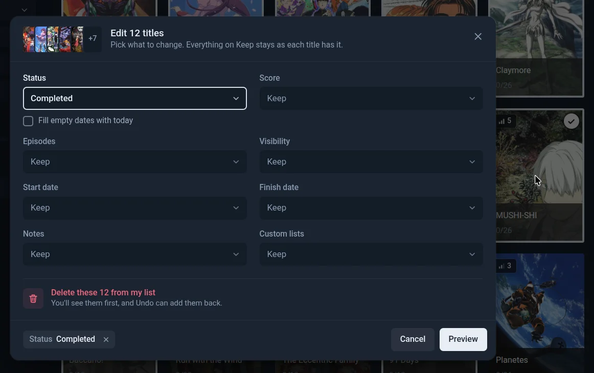
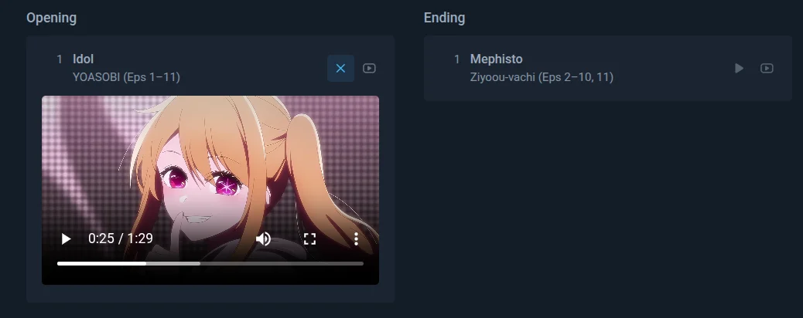
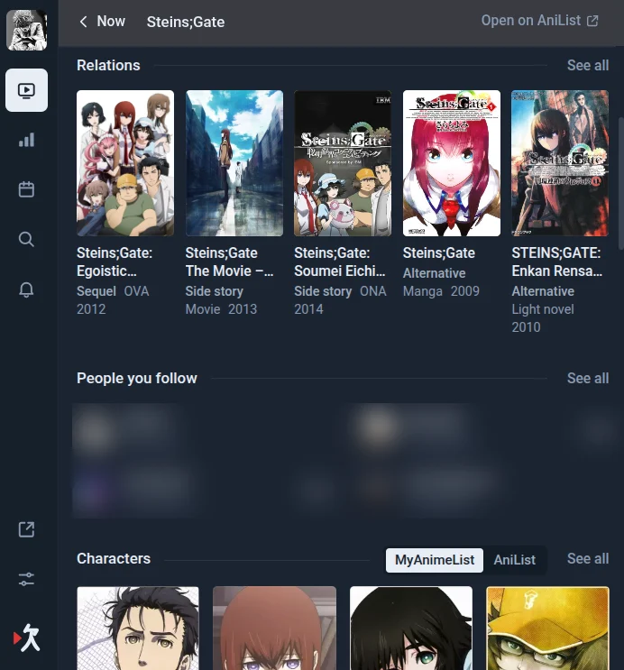
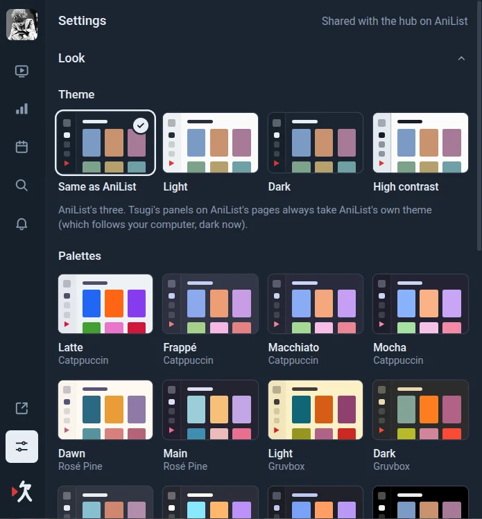

# Tsugi

Tsugi (次, "next") is a browser extension for [AniList](https://anilist.co).

It started as a small script to sort my Planning list by priority, because I never knew what to watch next. Then it kept growing. Now it adds the things I always missed on AniList, on AniList's own pages and in a popup on the toolbar, and it tries hard to look like it was always part of the site.

**Chrome Web Store: coming soon.** It works in Chrome, Brave, Edge, Opera and Vivaldi.

**In short:**

- Priorities and pins on your lists, so you always know what's next
- A popup on the toolbar with your lists, +1, search and full title pages
- Posters, new sorts, groups and filters on AniList's own list pages
- Two-way sync with MyAnimeList and MangaBaka
- NSFW titles made private in one go, or just hidden while you browse
- Mass edit, with a preview first and Undo after
- Ctrl+K, feed filters, watch-order warnings, 12 color palettes, and more

Everything can be turned off, and almost everything has an Undo.

## What it does

### Know what to watch next

Give your titles a priority right on your AniList lists, or pin up to five at the top. The pins of your Planning list become your Up Next. Priorities use AniList's own priority field, so other apps see them too. Custom lists get their own priorities and pins, and you can drag titles to set your own order inside one priority.

### The popup

Click Tsugi's button in the toolbar: what you're watching and reading as posters with +1, your Up Next, today's episodes, search and notifications. Click any poster for the title's page: your entry, editable in place, then relations, characters, staff, songs, reviews and where to watch. It can also open in its own window, in a tab or in the side panel.

 

### Your lists, your way

Posters, as a fourth layout next to AniList's own three. Sorts AniList doesn't have (priority, title without "The", length, release date...), groups (format, source, decade, length) and filters (source, streaming site, episode count, episode length) in AniList's own sidebar. Each list keeps its sort. And the list still shows up the way AniList draws it: no rows jumping around while it loads.

### Sync with MyAnimeList and MangaBaka

Connect them once and they follow your AniList list, both ways: a change made on any of the three reaches the other two within minutes, whether you made it in Tsugi, on the site itself or in a phone app. The first time, a Compare page shows what's different between them, and nothing is sent until you've seen it. The Sync log lists every change with an Undo button, and you decide what travels (scores, dates, rewatches, and what happens when you remove a title).

### NSFW titles, kept to yourself

You decide what counts as NSFW: AniList's 18+ mark, the Ecchi genre, AniList's 18+ tags, genres and tags of your own, or single titles you mark by hand. Tsugi shows you the titles it found and why each one counts, then makes them private on AniList in one go: only you see them on your profile and lists. One click undoes it. New ones you add later can become private by themselves. MyAnimeList has no private titles, so Tsugi can take them off your list there too, and put them back.

And if you just don't want them on screen, Hide NSFW titles takes them out of your list pages, Pick for me and search, without changing anything on AniList.

### Mass edit

Select titles on your list and change their status, score, progress, dates, notes, custom lists or visibility all at once. You see a preview first, and everything can be undone.

### More on every title

On AniList's title pages: MyAnimeList's score next to AniList's, MyAnimeList's characters if you prefer them, the openings and endings with a Play button (from AnimeThemes), and links to MyAnimeList and Reddit's discussions. In the popup, scores from MangaBaka, Kitsu and a few more sites.

### And the small things

- Ctrl+K on any AniList page: jump to a title, a list or a setting, or +1 without leaving the page
- Filters for the activity feed on Home (by kind, person or word), and the global feed hidden if you want
- A warning when a title comes after one you haven't seen yet
- Start and finish dates filled in for you, and a rewatch log rebuilt from your activity
- A list check: missing dates, sequels planned before their prequels, shows you forgot in Watching
- Pick for me, for when you can't decide
- Twelve color palettes (Catppuccin, Rosé Pine, Gruvbox, Nord, Dracula, Tokyo Night...)
- Follower counts on profiles, and why a profile page is missing

Everything can be turned off in Settings. If you only want the popup, you only get the popup.

More screenshots

 

## Privacy

Tsugi has no server. Your logins stay in your browser, and your list only goes to AniList and, if you connect them, to MyAnimeList and MangaBaka. No analytics, no ads, nothing sold. All the details are in [PRIVACY.md](PRIVACY.md).

## Install

- **Chrome Web Store:** coming soon.
- **By hand:** download the zip from [Releases](../../releases), unzip it, open `chrome://extensions`, turn on Developer mode, click "Load unpacked" and pick the folder.

Firefox isn't supported yet. If you'd use it, tell me in the [issues](../../issues), so I know how many people want it.

## Feedback

Found a bug, or missing something? Open an [issue](../../issues). I read them all.

## Thanks

Tsugi uses data from [AniList](https://anilist.co), [MyAnimeList](https://myanimelist.net) (through its API and [Tenrai](https://tenrai.org)), [AnimeThemes](https://animethemes.moe), [MangaBaka](https://mangabaka.org) ([CC BY-NC-SA 4.0](https://mangabaka.org/about/data-license)) and [Kitsu](https://kitsu.app). Other sites' icons are only used to show where a score or a link comes from: see [logos/README.md](logos/README.md). Text is set in Roboto ([OFL](fonts/OFL-Roboto.txt)).

Tsugi is an independent project. It isn't affiliated with or endorsed by AniList, MyAnimeList, or any other site it works with.

The code is public so you can see exactly what the extension does. All rights reserved.
